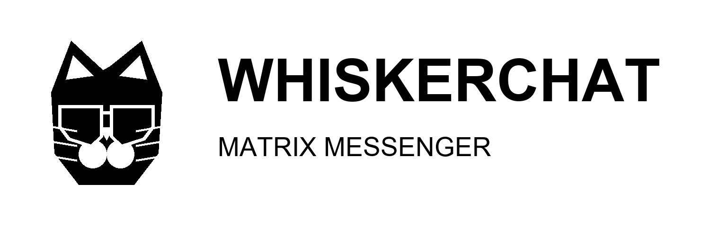

<!--
SPDX-FileCopyrightText: 2019-Present Christian Kußowski
SPDX-FileCopyrightText: 2019-Present Contributors to FluffyChat

SPDX-License-Identifier: AGPL-3.0-or-later
-->

# WhiskerChat



**A familiar kind of chat, on a network you can choose.**

WhiskerChat is an open-source messaging app for [Matrix](https://matrix.org), an open network for secure, real-time communication. Sign in with a Matrix account, talk with people on your homeserver and other servers, and use WhiskerChat alongside other compatible Matrix apps.

The interface pairs a black-and-white palette and crisp, squared edges with the feel of a classic desktop messenger. Underneath the retro look is a modern client for messages, rooms, communities, and calls.

[Downloads](https://github.com/thecathousemp3/whiskerchat/releases) · [Source code](https://github.com/thecathousemp3/whiskerchat) · [Report a problem](https://github.com/thecathousemp3/whiskerchat/issues)

## What you can do

### Talk your way

Send text, images, videos, files, voice messages, and location information in direct conversations or group rooms. Reply to a particular message, react, search your conversations, and use stickers, custom emotes, and polls where supported.

### Keep groups organized

Use rooms for conversations and Spaces to group related rooms into a community. Public rooms can help people find an existing community; private rooms let a group choose who can join. Room moderation tools help administrators manage membership and conversation settings.

### Call from a conversation

Start voice and video calls, including conferences. Call availability and call features can depend on the devices, network, and services used by participants.

### Make it yours

Choose light or dark appearance, personalize your profile, and set up notifications. The WhiskerChat interface uses a restrained monochrome style, while images and other media shared by people remain in their original colors.

## A note about the design

The banner above is WhiskerChat artwork, not a screenshot of the running app. The previous store screenshots showed the old interface and were removed rather than presented as current. New app screenshots will be added after they can be captured from a current build.

## How Matrix works

Matrix is a communication protocol, not one company’s chat service. A homeserver stores your account and helps deliver messages. You can select a homeserver when creating an account, or use an existing Matrix account. Your Matrix ID identifies you on the network, and people using other Matrix clients can join the same conversations.

Your choice of homeserver matters. The server operator may manage account registration, retention, availability, and access to your account data. Review the server’s policies and choose an operator you trust. Running a homeserver yourself is also an option, though it requires separate server administration.

Matrix supports end-to-end encryption in eligible conversations. In an encrypted room, devices exchange keys so that the room’s messages are intended to be readable only by its participants. Encryption does not protect every part of using a chat service: for example, a server still handles account and delivery information. Verify devices and people when appropriate, and understand how recovery works before relying on encrypted backups. Available encryption and recovery features depend on room settings and the devices involved.

## Getting started

1. Install WhiskerChat from a download in [Releases](https://github.com/thecathousemp3/whiskerchat/releases), when a build for your device is available.
2. Sign in with an existing Matrix account, or register with a homeserver that allows new accounts.
3. Find someone by their Matrix ID, or open a room invitation.
4. For encrypted conversations, review device verification and key backup settings so you know how to recover access if you change devices.

You do not need to run a Matrix server to use WhiskerChat. If you do not have an account yet, choose a homeserver during registration. Some servers disable public registration or require an invitation.

## Build from source

WhiskerChat is built with Flutter and includes a Rust-based dependency for cryptographic support. Install a compatible [Flutter SDK](https://flutter.dev) and [Rust toolchain](https://www.rust-lang.org/tools/install), then clone the repository:

```sh
git clone https://github.com/thecathousemp3/whiskerchat.git
cd whiskerchat
flutter pub get
```

Connect a supported device or start a desktop target configured for Flutter, then run:

```sh
flutter run
```

Flutter platform requirements vary. Consult the [Flutter installation guide](https://docs.flutter.dev/get-started/install) for the SDK and native tooling required by your operating system and target device.

### Web

Prepare the Vodozemac web dependency before running or building for web:

```sh
./scripts/prepare-web.sh
```

To customize web settings, serve a `config.json` with the app. The available options and example values are documented in [`config.sample.json`](config.sample.json).

### Integration tests

Install Docker and prepare the integration-test environment:

```sh
./scripts/prepare_integration_test.sh
```

Then run the mobile integration test:

```sh
flutter test integration_test/mobile_test.dart
```

## Help and contributions

If you find a problem, first check the existing [issues](https://github.com/thecathousemp3/whiskerchat/issues). If it has not already been reported, open a new issue with the steps to reproduce it, what you expected to happen, and what happened instead. Avoid including private messages, access tokens, or other personal information in reports.

Contributions are welcome. Before opening a pull request, describe the problem your change solves, keep changes focused, and run the relevant checks for the files you changed. Please retain the project’s license notices when modifying existing files.

## License

WhiskerChat is free software licensed under the [GNU Affero General Public License, version 3 or later](LICENSE).
